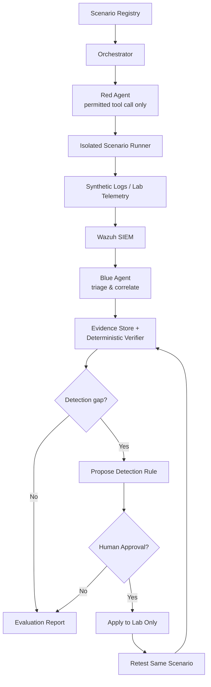

# Purple Sentinel

**Multi-Agent Purple Team Security Validation Platform**

Red Agent가 실습 환경에서 공격 시나리오를 실행하고, Blue Agent가 SIEM 로그로 이를 탐지·분석하면, 독립 검증기가 증거를 기준으로 "탐지됐는가"를 판정하는 퍼플팀 자동화 플랫폼입니다. 탐지 공백이 확인되면 룰 개선안을 제안하고, 사람의 승인을 거쳐 실습 환경에만 적용한 뒤 같은 시나리오로 재검증합니다.

BAS(Breach and Attack Simulation) 운영, 침투테스트, 보안관제 협업 경험에서 반복적으로 수작업하던 **"공격 재현 → 탐지 확인 → 개선 → 재시험"** 사이클을 AI 에이전트로 자동화하는 것이 목표입니다.

> **Status: 🚧 In progress — Sprint 1** (2026.10.19 – 11.08)
> 현재는 기반 모듈(합성 보안 로그 분석, CLI, 테스트)을 구현하는 단계입니다. 아래 [Roadmap](#roadmap)에 구현 완료와 계획을 구분해 표시합니다.

---

## Architecture (target)



**Design principles**

- **LLM은 판정하지 않는다.** 에이전트의 주장은 검증의 입력일 뿐이며, 최종 판정은 기대 결과와 실제 증거를 비교하는 결정론적 Verifier가 내립니다.
- **Observed / Detected / Prevented를 구분한다.** 로그에 남은 것과 경보가 발생한 것, 실제로 차단된 것은 서로 다른 결과로 기록합니다. 근거가 부족하면 `Inconclusive`로 남깁니다.
- **에이전트도 공격 표면이다.** SIEM 로그는 비신뢰 데이터로 취급하고(Prompt Injection 대응), 모든 Tool Call은 Allowlist·스키마 검사를 통과해야 하며, 룰 변경은 사람의 승인 없이 적용되지 않습니다.
- **실습 환경과 합성 데이터만 사용한다.** 허가되지 않은 대상에 대한 실행은 설계 단계에서 차단합니다.

## Roadmap

| Milestone | 내용 | 상태 |
|---|---|---|
| M0 | Python 개발 환경, pytest, Git 워크플로 | ✅ 완료 |
| M1 | 합성 보안 이벤트 생성·조회 | 🚧 진행 중 |
| M2 | Wazuh SIEM 로그·경보 연동 | ⏳ 계획 |
| M3 | Red/Blue LLM Agent 및 Tool Calling | ⏳ 계획 |
| M4 | Orchestration (상태 관리·재시도·승인 대기) | ⏳ 계획 |
| M5 | Deterministic Verifier | ⏳ 계획 |
| M6 | Human Approval → Retest Closed Loop | ⏳ 계획 |
| M7 | Agent Security 검증 (Prompt Injection, Tool 오용) | ⏳ 계획 |

## Current implementation

현재 구현된 것은 탐지 파이프라인의 첫 단계인 **보안 로그 분석 모듈**입니다.

- `purple_sentinel.security_logs.count_failed_logins` — 합성 SSH 인증 로그에서 IP별 로그인 실패 횟수를 집계하고, 필수 필드(`ip`, `status`)가 없는 이벤트는 예외로 거부
- `purple_sentinel` CLI — `--demo` 옵션으로 합성 로그 분석 실행
- pytest 단위 테스트 7개 — 정상·음성·빈 입력·필수 필드 누락 등 경계 조건 포함

### Quick start

Python 3.10 이상이 필요합니다.

```bash
git clone https://github.com/dankang09/purple-sentinel.git
cd purple-sentinel

python -m venv .venv
source .venv/bin/activate        # Windows PowerShell: .venv\Scripts\Activate.ps1
pip install pytest

python -m purple_sentinel --help
python -m purple_sentinel --demo
python -m pytest -q
```

Expected output:

```text
$ python -m purple_sentinel --demo
Failed login counts: {'192.0.2.10': 2}

$ python -m pytest -q
7 passed
```

데모와 테스트의 IP는 문서용으로 예약된 대역(`192.0.2.0/24`, RFC 5737)만 사용합니다.

## Project structure

```text
purple_sentinel/
├── __main__.py        # python -m purple_sentinel 진입점
├── cli.py             # argparse 기반 CLI
└── security_logs.py   # 보안 로그 분석 로직
test_security_logs.py  # 로그 분석 단위 테스트
```

## Development log

개발 과정은 커밋 단위로 기록합니다. 커밋 메시지는 [Conventional Commits](https://www.conventionalcommits.org/) 형식을 따릅니다.

| Day | 내용 |
|---|---|
| 1 · 10/19 | 개발 환경 구성, 첫 단위 테스트 |
| 2 · 10/20 | IP별 로그인 실패 집계 함수와 테스트 |
| 3 · 10/21 | 필수 필드 검증, 예외 테스트 |
| 4 · 10/22 | Python 패키지 구조화, argparse CLI |

---

<sub>개인 학습·포트폴리오 프로젝트입니다. 모든 데이터는 합성 데이터이며, 특정 기관의 내부 환경·정책·로그를 포함하지 않습니다.</sub>
